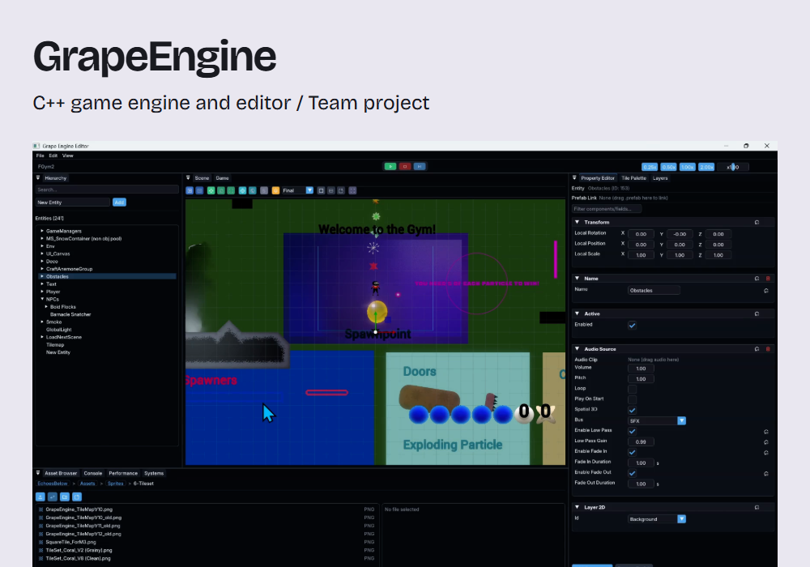

<h1>Foo Rui Qin</h1>

I study computer science at DigiPen/SIT in Singapore and am looking for software engineering internships. Before this, I studied accountancy and finance. My projects focus on C++ game engine tools and backend systems.

Assetwise is where the finance background shows up. TikTok 2020 is what happened when I realised I’d missed a whole corner of lockdown internet.

<a href="https://foo-rq.github.io/">Portfolio</a> / <a href="mailto:ruiqinfoo@gmail.com">Email</a> / <a href="https://www.linkedin.com/in/rui-qin-foo/">LinkedIn</a> / <a href="assets/resume.pdf">Résumé</a>

 

<a href="#grapeengine">GrapeEngine</a> / <a href="#assetwise">Assetwise</a> / <a href="#tiktok-2020">TikTok 2020</a> / <a href="#more-engineering-work">More engineering work</a>

<h2>GrapeEngine</h2>

Our team built a C++ game engine and editor for <em>Echoes Below</em>. The editor lets the team assemble levels and edit game entities and their components.

I built the memory-pool allocator and worked on cached resource loading and editor tools, including selection, copy/paste, undo and prefabs.

<a href="https://foo-rq.github.io/grapeengine.html">Read the project write-up</a> / <a href="https://github.com/Chaotic-Grapes/GrapeEngine">Browse the engine source</a> / <a href="assets/grapeengine-editor-demo.mp4?raw=true">Open the 20-second editor demo (MP4)</a>

My engine work, in more detail

I built a memory-pool allocator with an address-ordered free list. I also worked on resource caching, entity/component editing and prefab tools.

Team project. The editor screenshot and normal-speed, muted recording come from team footage. My contributions are described above.

C++ / Dear ImGui / CMake

<h2>Assetwise</h2>

Assetwise is a portfolio analysis web app for building practice portfolios and comparing allocations. It shows when funds hold the same companies and puts estimated risk and growth beside each proposed change.

I built the Python/FastAPI backend, plain JavaScript interface and SQLite portfolio storage. Saves catch conflicting edits rather than overwrite a newer version.

<a href="https://foo-rq.github.io/assetwise.html">Explore Assetwise</a>

See a portfolio comparison

<a href="assets/assetwise-portfolio.png">Open the full portfolio screenshot</a>

The estimates make the trade-off visible: less estimated risk can also mean less estimated growth.

Python / FastAPI / SQLite / JavaScript

Independent project, still in development. The archive covers 46 stocks and funds from 2013 to 2017. No live prices or real trades.

<h2>TikTok 2020</h2>

I didn’t use TikTok during lockdown. When I came across videos from that year later, I wanted to keep scrolling through 2020.

TikTok 2020 is a browser app for archived videos and comments, with a feed, Discover, search and saved likes. I built it with plain JavaScript.

  

<a href="https://foo-rq.github.io/tiktok-2020.html">Read the project write-up</a> / <a href="assets/tiktok-portfolio-demo.mp4?raw=true">Open the 18-second app demo (MP4)</a> / <a href="https://github.com/foo-rq/tiktok-2020">Browse the source</a>

Independent project, plain JavaScript. The demo shows playback, sound, comments, swiping, Discover, search and Inbox. Videos and comments belong to their original creators.

<h2>More engineering work</h2>
<h3>Spatia</h3>

Spatia team editor, running locally with a sample exhibition.

A team-built browser editor for creating and publishing interactive 3D exhibitions. I worked on shared TypeScript/C# document validation, draft recovery and revision-aware autosave, plus publication access and asset administration. The project is ongoing.

<a href="https://foo-rq.github.io/spatia.html">Read about my Spatia work</a>

More about my Spatia work

My work also includes serialization and reconstruction, IndexedDB recovery, import/export, protected asset delivery and deployment checks. The screenshot shows the team application with a local sample exhibition.

TypeScript / C# / PostgreSQL

<h3>TradingSystem</h3>

TradingSystem team interface, using simulated market data.

A team-built simulated trading platform, with a C++ server and web interface for viewing markets and placing orders. I added concurrent client handling, atomic settlement and persisted order sequencing so price-time priority survives a restart.

<a href="https://foo-rq.github.io/trading-system.html">Read about my trading backend work</a>

More about my trading backend work

I worked on per-connection client workers, checked settlement writes and rollback handling. Related work includes persisting the latest price and validating JWT expiry.

C++ / Winsock / SQLite

The screenshot shows the team interface with simulated data. My contribution is to the backend.

I’ve also been a C/C++ teaching assistant at DigiPen and a finance intern at GetGo. I’m looking for software engineering internships, especially in systems and backend development.

<a href="mailto:ruiqinfoo@gmail.com">Get in touch</a> / <a href="assets/resume.pdf">Read my résumé</a>

Some source repositories remain private. Team-project descriptions refer to my contributions.

