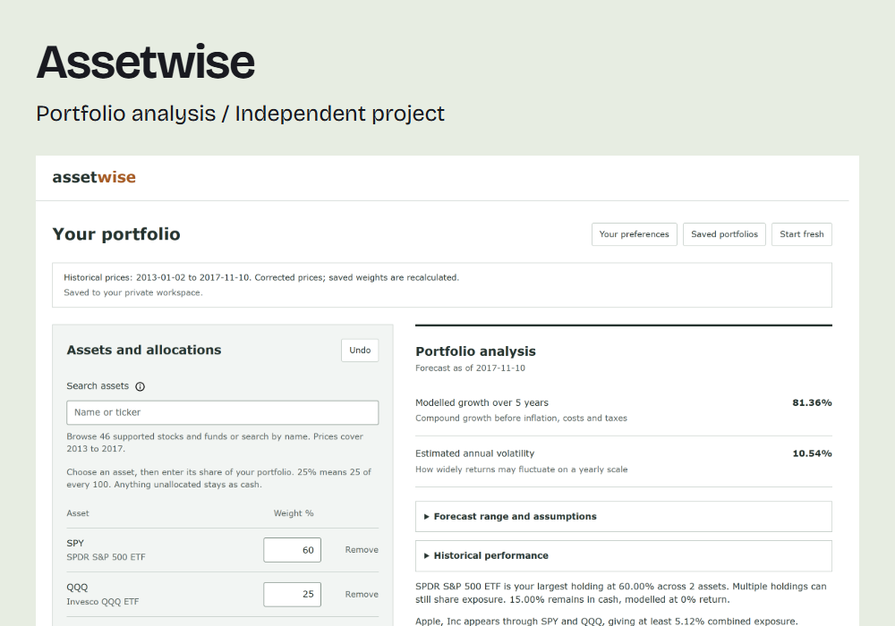
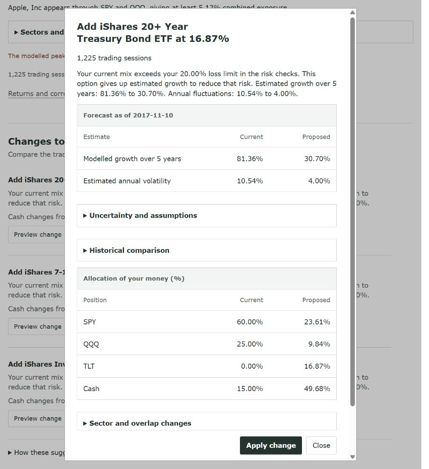
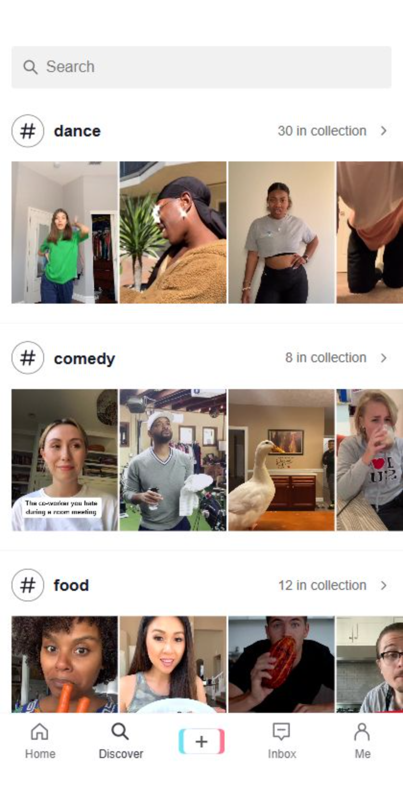
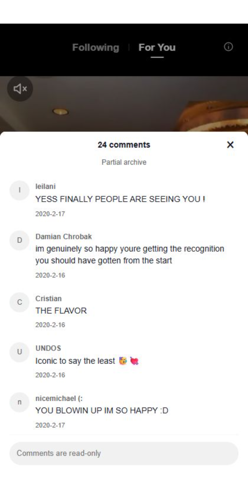

<h1>Foo Rui Qin</h1>

I’m a computer science student at DigiPen/SIT in Singapore, looking for software engineering internships. I work on C++ game engine tools, backend systems and web applications.

Before computer science, I studied accountancy and finance. I’ve also been a C/C++ teaching assistant at DigiPen.

<a href="https://foo-rq.github.io/">Portfolio</a> / <a href="mailto:ruiqinfoo@gmail.com">Email</a> / <a href="https://www.linkedin.com/in/rui-qin-foo/">LinkedIn</a>

 

<a href="#grapeengine">GrapeEngine</a> / <a href="#coin-rush">Coin Rush</a> / <a href="#assetwise">Assetwise</a> / <a href="#spatia">Spatia</a> / <a href="#tradingsystem">TradingSystem</a> / <a href="#tiktok-2020">TikTok 2020</a>

<h2>GrapeEngine</h2>

Team project / Technical lead / C++, Dear ImGui, CMake

Our team built a C++ game engine and editor for <em>Echoes Below</em>. The editor lets the team assemble levels and edit game entities and their components.

I built the memory-pool allocator and worked on cached resource loading and editor tools, including selection, copy/paste, undo and prefabs.

<a href="https://foo-rq.github.io/grapeengine.html">Read the project write-up</a> / <a href="https://github.com/Chaotic-Grapes/GrapeEngine">Browse the engine source</a> / <a href="assets/grapeengine-editor-demo.mp4?raw=true">Open the 20-second editor demo (MP4)</a>

My engine work, in more detail

I built a memory-pool allocator with an address-ordered free list. I also worked on resource caching, entity/component editing and prefab tools.

Team project. The editor screenshot and normal-speed, muted recording come from team footage. My contributions are described above.

<h2>Coin Rush</h2>

Team project / C, Cyclone DDS, OpenSSL

A team-built C game for two to five players: catch coins, dodge bombs and settle a tie with another round. I worked on DDS networking and security, match progression and Linux profiling.

<a href="https://foo-rq.github.io/coin-rush.html">Read the project write-up</a> / <a href="https://github.com/jingwen121/LLPAssignment">Browse the team source</a>

More about my networking and profiling work

I configured certificate identities, signed topic permissions and encrypted DDS traffic. I compared four variants with Linux perf over 100 runs each, measuring 14.19% lower mean batch runtime for SSE2 than scalar. A teammate implemented SIMD; my work here was profiling and analysis. This measures the batch workload, not game frame rate.

<h2>Assetwise</h2>

Independent project / Python, FastAPI, SQLite, JavaScript

Assetwise is a portfolio analysis web app for building practice portfolios and comparing allocations. It shows when funds hold the same companies and puts estimated risk and growth beside each proposed change.

I built the Python/FastAPI backend, plain JavaScript interface and SQLite portfolio storage. Saves catch conflicting edits rather than overwrite a newer version.

<a href="https://foo-rq.github.io/assetwise.html">Read the project write-up</a> / <a href="https://github.com/foo-rq/assetwise">Browse the source</a>

See a portfolio comparison

The estimates make the trade-off visible: less estimated risk can also mean less estimated growth.

<h2>Spatia</h2>

Team project, ongoing / TypeScript, C#, PostgreSQL

A team-built browser editor for creating and publishing interactive 3D exhibitions. I worked on shared TypeScript/C# document validation, draft recovery and revision-aware autosave, plus publication access and asset administration. The project is ongoing.

<a href="https://foo-rq.github.io/spatia.html">Read about my Spatia work</a>

More about my Spatia work

My work also includes serialization and reconstruction, IndexedDB recovery, import/export, protected asset delivery and deployment checks. The screenshot shows the team application with a local sample exhibition.

<h2>TradingSystem</h2>

Team project / C++, Winsock, SQLite

A team-built simulated trading platform, with a C++ server and web interface for viewing markets and placing orders. I added concurrent client handling, atomic settlement and persisted order sequencing so price-time priority survives a restart.

<a href="https://foo-rq.github.io/trading-system.html">Read about my trading backend work</a>

More about my trading backend work

I worked on per-connection client workers, checked settlement writes and rollback handling. Related work includes persisting the latest price and validating JWT expiry.

The screenshot shows the team interface with simulated data. My contribution is to the backend.

<h2>TikTok 2020</h2>

Independent project / JavaScript, HTML, CSS

TikTok 2020 is a browser app for archived videos and comments. I built the feed, Discover, search and saved likes with plain JavaScript.

I wasn’t on TikTok during lockdown, so I built this to browse the videos I’d missed.

  

<a href="https://foo-rq.github.io/tiktok-2020.html">Read the project write-up</a> / <a href="assets/tiktok-portfolio-demo.mp4?raw=true">Open the 18-second app demo (MP4)</a> / <a href="https://github.com/foo-rq/tiktok-2020">Browse the source</a>

Independent project, plain JavaScript. The demo shows playback, sound, comments, swiping, Discover, search and Inbox. Videos and comments belong to their original creators.

<a href="mailto:ruiqinfoo@gmail.com">Get in touch</a>

Some source repositories remain private. Team-project descriptions refer to my contributions.

