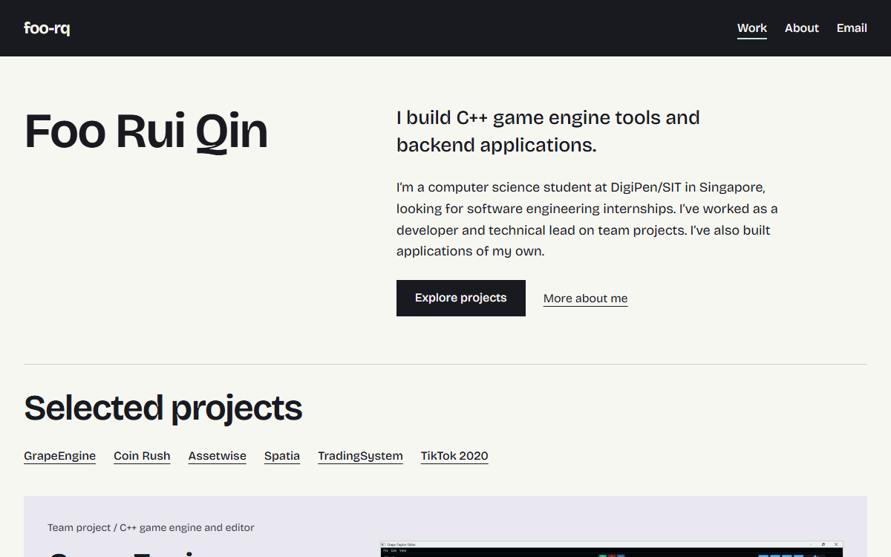
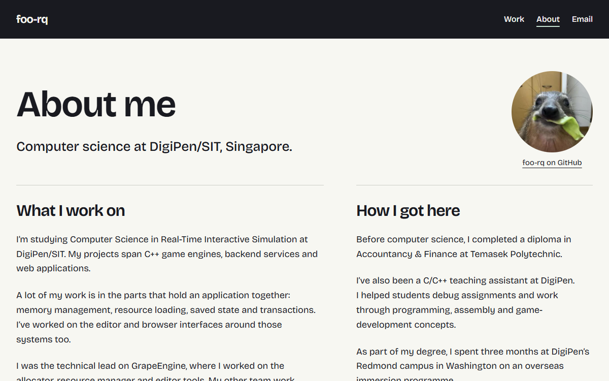
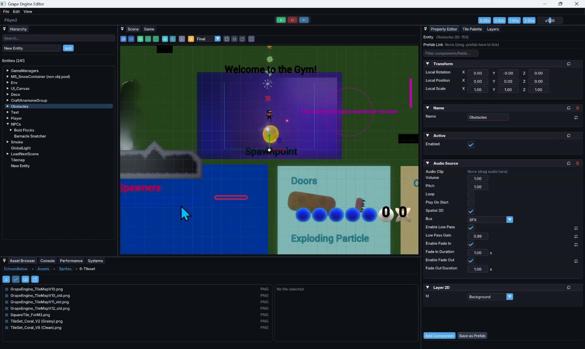
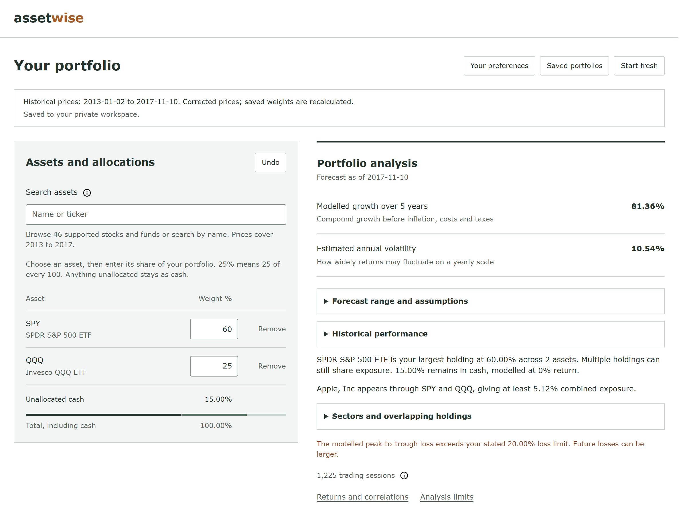
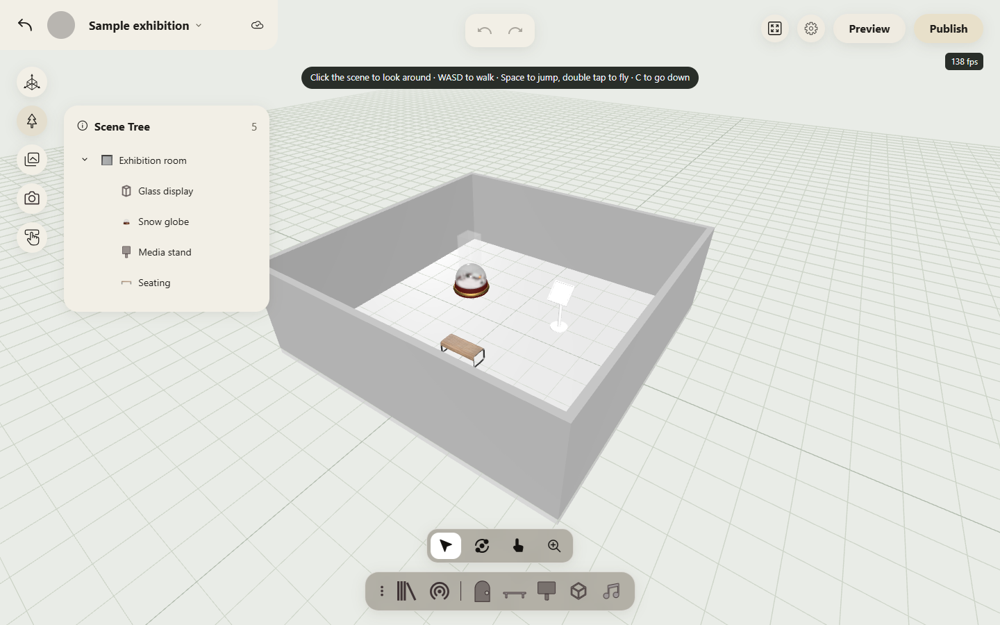
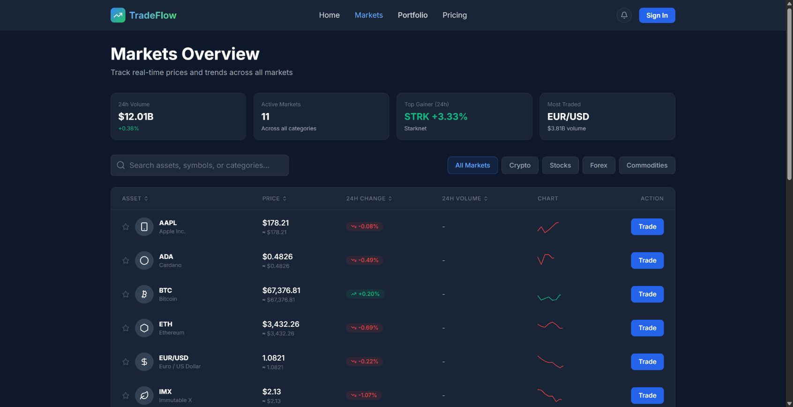
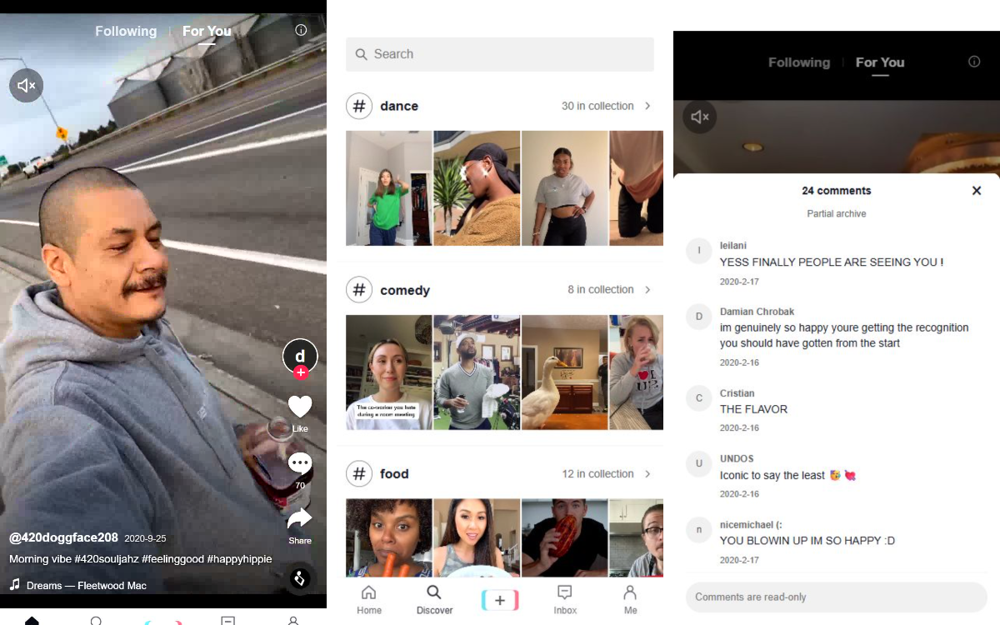

<h1>Foo Rui Qin</h1>

I’m a computer science student at DigiPen/SIT in Singapore, looking for software engineering internships. I work on C++ game engine tools, backend systems and web applications.

Before computer science, I studied accountancy and finance. I’ve also been a C/C++ teaching assistant at DigiPen.

<a href="https://foo-rq.github.io/">Portfolio</a> / <a href="mailto:ruiqinfoo@gmail.com">Email</a> / <a href="https://www.linkedin.com/in/rui-qin-foo/">LinkedIn</a>

 

<a href="https://foo-rq.github.io/">Portfolio</a> / <a href="mailto:ruiqinfoo@gmail.com">Email</a> / <a href="https://www.linkedin.com/in/rui-qin-foo/">LinkedIn</a>

<h2>GrapeEngine</h2>

Team project / Technical lead / C++, Dear ImGui, CMake

A C++ game engine and editor built for <em>Echoes Below</em>. I built the memory-pool allocator and worked on resource caching, entity/component editing, prefabs, selection, copy/paste and undo.

<a href="https://foo-rq.github.io/grapeengine.html">Project details</a> / <a href="https://github.com/Chaotic-Grapes/GrapeEngine">Source</a> / <a href="https://foo-rq.github.io/assets/grapeengine-editor-demo.mp4">Editor video</a>

<h2>Coin Rush</h2>

Team project / C, Cyclone DDS, OpenSSL

A multiplayer game for two to five players: catch coins, dodge bombs and settle a tie with another round. I worked on DDS networking and security, match progression and Linux performance analysis.

<a href="https://foo-rq.github.io/coin-rush.html">Project details</a> / <a href="https://github.com/jingwen121/LLPAssignment">Source</a>

<h2>Assetwise</h2>

Independent project / Python, FastAPI, SQLite, JavaScript

A portfolio analysis app for comparing allocations, overlapping fund holdings and estimated risk and growth. I built the interface, Python/FastAPI backend and SQLite storage, including revision checks that protect newer edits from stale saves.

<a href="https://foo-rq.github.io/assetwise.html">Project details</a> / <a href="https://github.com/foo-rq/assetwise">Source</a> / <a href="https://assetwise-demo.onrender.com/">Open live app</a>

<h2>Spatia</h2>

Team project, ongoing / TypeScript, C#, PostgreSQL

A browser editor for creating and publishing interactive 3D exhibitions. My work covers shared document validation, draft recovery, revision-aware autosave, publication access and asset administration.

<a href="https://foo-rq.github.io/spatia.html">Project details</a>

<h2>TradingSystem</h2>

Team project / C++, Winsock, SQLite

A simulated trading platform with a C++ server and web interface. I added concurrent client handling, atomic trade settlement and persisted order sequencing so price-time priority survives a restart.

<a href="https://foo-rq.github.io/trading-system.html">Project details</a>

<h2>TikTok 2020</h2>

Independent project / JavaScript, HTML, CSS

I wasn’t on TikTok during lockdown, so I built a browser app for the videos I’d missed. I built the feed, Discover, search, archived comments and saved likes with plain JavaScript.

<a href="https://foo-rq.github.io/tiktok-2020.html">Project details</a> / <a href="https://github.com/foo-rq/tiktok-2020">Source</a> / <a href="https://foo-rq.github.io/tiktok-2020/">Open live app</a> / <a href="https://foo-rq.github.io/assets/tiktok-portfolio-demo.mp4">Video walkthrough</a>

<a href="mailto:ruiqinfoo@gmail.com">Get in touch</a>

